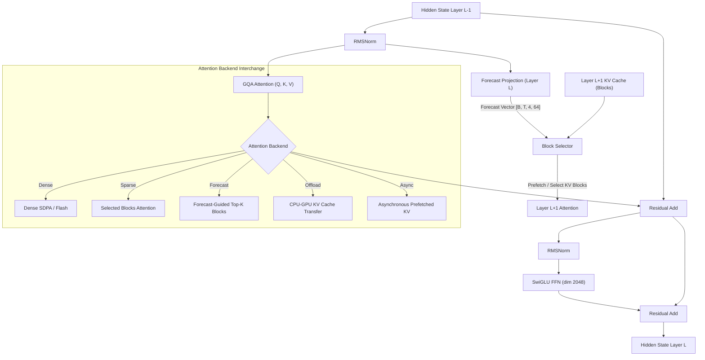

# SparDA-Style Local Research Model: Implementation Plan

## Goal Description

Build a small language model (~84M parameters) and an experimental modular attention system **from scratch** (initialized from random weights) targeted for local execution on a **16 GB NVIDIA RTX 4090-class GPU**. 

The system investigates:
1. **Forecast-based sparse attention** (predicting Layer $L+1$ KV requirements at Layer $L$)
2. **Long-context inference** scaling from 1K to 32K context lengths
3. **KV-cache reduction and offloading** between CPU and GPU
4. **Asynchronous CPU $\leftrightarrow$ GPU KV prefetch** overlapping transfer with compute
5. **Continual learning, replay, and catastrophic forgetting dynamics** in forecast-equipped vs. dense architectures

Following the specification in [SparDA-Style Local Research Model.md](SparDA-Style%20Local%20Research%20Model.md), development is strictly organized into phased milestones, starting with a clean, verifiable, and benchmarked **Dense Baseline (Phase 1 & 2)** before introducing sparse or forecast mechanics.

---

## Environment & Hardware Setup (Verified)

- **Conda Environment**: `local_slm` (`C:\Users\tybor\miniconda3\envs\local_slm`)
- **Python Executable**: `C:\Users\tybor\miniconda3\envs\local_slm\python.exe` (Python 3.11.17)
- **PyTorch**: `2.6.0+cu124` with native CUDA acceleration
- **GPU**: NVIDIA GeForce RTX 4090 Laptop GPU (16,376 MiB VRAM, compute capability `sm_89` Ada Lovelace)
- **BF16 Support**: Native hardware support verified (`torch.cuda.is_bf16_supported() == True`)
- **Core Dependencies**: `torch`, `torchvision`, `tokenizers`, `transformers`, `datasets`, `pyyaml`, `tqdm`, `pytest`
- **Execution Command Format**:
  `& "C:\Users\tybor\miniconda3\envs\local_slm\python.exe" <script.py>` or `conda run -n local_slm python <script.py>`

---

## Architecture Specification

```
Model Configuration:
├── vocab_size:       32,000 (tied input/output embeddings)
├── n_layer:          12
├── n_embd:           768
├── n_head:           12 (Query heads)
├── n_kv_head:        4  (KV heads, GQA ratio 3:1)
├── head_dim:         64
├── ffn_dim:          2,048 (SwiGLU)
├── forecast_heads:   4
├── forecast_dim:     64
└── context_length:   1,024 (initial; scalable to 2K, 4K, 8K, 16K, 32K)

Total parameters: ~84.3M parameters
```

### Layer Structure & Forecast Data Flow



---

## Repository Structure

```
local-research-LLM/
├── SparDA-Style Local Research Model.md
├── IMPLEMENTATION_PLAN.md
├── pyproject.toml
├── requirements.txt
│
├── configs/
│   ├── base.yaml
│   ├── 1k.yaml
│   ├── 4k.yaml
│   ├── 8k.yaml
│   └── 16k.yaml
│
├── model/
│   ├── __init__.py
│   ├── config.py
│   ├── embeddings.py
│   ├── norm.py
│   ├── rope.py
│   ├── attention/
│   │   ├── __init__.py
│   │   ├── base.py
│   │   ├── dense.py
│   │   ├── sparse.py
│   │   ├── forecast.py
│   │   ├── offload.py
│   │   └── async_offload.py
│   ├── forecast.py
│   ├── transformer.py
│   └── model.py
│
├── data/
│   ├── __init__.py
│   ├── tokenizer.py
│   ├── dataset.py
│   ├── packing.py
│   └── preprocessing.py
│
├── training/
│   ├── __init__.py
│   ├── trainer.py
│   ├── losses.py
│   ├── replay.py
│   ├── continual.py
│   └── checkpoint.py
│
├── evaluation/
│   ├── __init__.py
│   ├── perplexity.py
│   ├── forecast_metrics.py
│   ├── latency.py
│   ├── memory.py
│   └── forgetting.py
│
├── benchmarks/
│   ├── __init__.py
│   ├── dense.py
│   ├── sparse.py
│   ├── forecast.py
│   └── long_context.py
│
├── scripts/
│   ├── prepare_data.py
│   ├── train.py
│   ├── evaluate.py
│   ├── generate.py
│   └── benchmark.py
│
├── tests/
│   ├── __init__.py
│   ├── test_attention.py
│   ├── test_forecast.py
│   ├── test_model.py
│   └── test_training.py
│
└── docs/
    ├── architecture.md
    ├── experiments.md
    └── results.md
```

---

## Phased Roadmap

### Phase 1: Base Model Architecture & Tokenizer (Milestone 1)
1. **Core Model Modules**:
   - `model/config.py`: `ModelConfig` dataclass matching specification.
   - `model/norm.py`: Numerical stable `RMSNorm`.
   - `model/rope.py`: Rotary Position Embeddings (RoPE).
   - `model/embeddings.py`: `TiedEmbedding` for shared input and output LM head.
   - `model/transformer.py`: `SwiGLU` FFN + `TransformerBlock`.
   - `model/model.py`: Full `SparDAResearchModel` (~84M params).
2. **Attention Backend**:
   - `model/attention/base.py`: Pluggable attention base interface.
   - `model/attention/dense.py`: Dense GQA via PyTorch SDPA with RoPE.
3. **Tokenizer & Data**:
   - `data/tokenizer.py`: Trainable Byte-fallback BPE (32K vocab).
   - `data/dataset.py`: Memory-mapped sequence dataset with packing.
   - `scripts/prepare_data.py`: Automated download and tokenization of training corpus.
4. **Phase 1 Verification**:
   - Parameter count check (~84.3M), tied weight identity, causal masking test.

### Phase 2: Production-Quality Baseline & Profiling
- BF16 mixed-precision training loop (`training/trainer.py`).
- Gradient checkpointing & accumulation.
- Atomic checkpoint saving/loading (`training/checkpoint.py`).
- Autoregressive generation script (`scripts/generate.py`).
- Baseline VRAM & tokens/sec profiling (`evaluation/memory.py`, `evaluation/latency.py`).

### Phase 3: Forecast Module & Predictive Selection
- `model/forecast.py`: $W_f \in \mathbb{R}^{d_{model} \times (n_{kv\_head} \times d_{forecast})}$ layer-ahead predictor.
- KV block representation compressor.
- Teacher-student loss (`training/losses.py`) and `Recall@K` evaluation (`evaluation/forecast_metrics.py`).

### Phase 4: Sparse Attention Backend
- `model/attention/sparse.py`: Block-sparse attention with top-$k$ block gather.
- `model/attention/forecast.py`: Forecast-guided block selection for Layer $L+1$.
- Benchmark Dense vs. Sparse across context lengths.

### Phase 5 & 6: KV Offloading & Asynchronous Prefetch
- Pinned CPU host memory KV cache (`model/attention/offload.py`).
- Asynchronous prefetch using secondary CUDA stream overlapping with Layer $L$ computation (`model/attention/async_offload.py`).
- Wall-clock transfer vs. compute benchmarks.

### Phase 7 & 8: Continual Learning & Full Scaling Matrix
- Experience replay buffer (5–20%) and continual training loop (`training/replay.py`, `training/continual.py`).
- Context scaling evaluation (1K $\to$ 2K $\to$ 4K $\to$ 8K $\to$ 16K $\to$ 32K).
- Full 5-experiment matrix execution.
