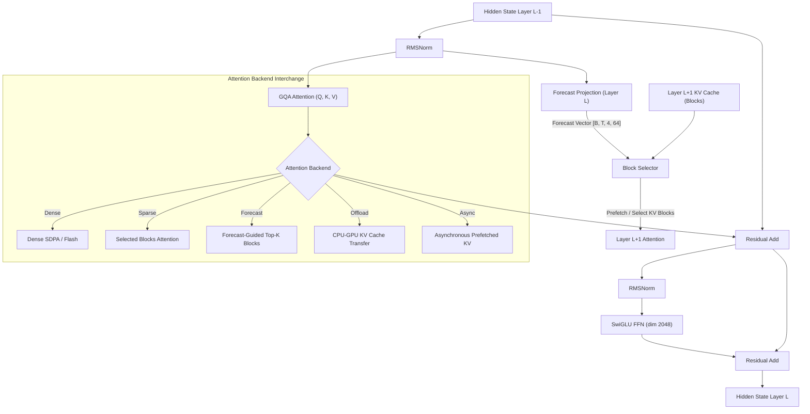

# SparDA-Style Local Research Model: Implementation Plan & Session Handoff

## Goal Description

Build a small language model (~84M parameters) and an experimental modular attention system **from scratch** (initialized from random weights) targeted for local execution on **16 GB NVIDIA RTX-Series GPUs**. 

The system investigates:
1. **Forecast-based sparse attention** (predicting Layer $L+1$ KV requirements at Layer $L$)
2. **Long-context inference** scaling from 1K to 32K context lengths
3. **KV-cache reduction and offloading** between CPU and GPU
4. **Asynchronous CPU $\leftrightarrow$ GPU KV prefetch** overlapping transfer with compute
5. **Continual learning, replay, and catastrophic forgetting dynamics** in forecast-equipped vs. dense architectures

Following the specification in [SparDA-Style Local Research Model.md](SparDA-Style%20Local%20Research%20Model.md), development is strictly organized into phased milestones, starting with a clean, verifiable, and benchmarked **Dense Baseline (Phase 1 & 2)** before introducing sparse or forecast mechanics.

---

## Environment & Hardware Setup (Verified)

- **Conda Environment**: `local_slm` (`C:\Users\tybor\miniconda3\envs\local_slm`)
- **Python Executable**: `C:\Users\tybor\miniconda3\envs\local_slm\python.exe` (Python 3.11.17)
- **PyTorch**: `2.6.0+cu124` with native CUDA acceleration
- **GPU Target**: 16 GB NVIDIA RTX-Series GPUs *(Testbed: NVIDIA GeForce RTX 4090 Laptop GPU, 16,376 MiB VRAM, compute capability `sm_89` Ada Lovelace)*
- **BF16 Support**: Native hardware support verified (`torch.cuda.is_bf16_supported() == True`)
- **Core Dependencies**: `torch`, `torchvision`, `tokenizers`, `transformers`, `datasets`, `pyyaml`, `tqdm`, `pytest`
- **Execution Command Format**:
  `& "C:\Users\tybor\miniconda3\envs\local_slm\python.exe" <script.py>` or `conda run -n local_slm python <script.py>`
- **Test Command**:
  `& "C:\Users\tybor\miniconda3\envs\local_slm\python.exe" -m pytest -v` (12 tests currently passing)

> [!IMPORTANT]
> **Power Profile Note (Post-Completion Re-evaluation)**:
> Development and Phase 1 milestone runs were conducted with the testbed laptop operating in **Eco Mode with dGPU** (power capped to ~80W TGP). **Upon full project completion, all latency, throughput, and scaling benchmarks must be re-run in full Performance Mode** (uncapping TGP to 150W–175W with maximum boost clocks and memory bus bandwidth) to establish definitive publication-grade numbers.

---

## Architecture Specification

```
Model Configuration:
├── vocab_size:       32,000 (tied input/output embeddings)
├── n_layer:          12
├── n_embd:           768
├── n_head:           12 (Query heads)
├── n_kv_head:        4  (KV heads, GQA ratio 3:1)
├── head_dim:         64
├── ffn_dim:          2,048 (SwiGLU: w_gate, w_up, w_down)
├── forecast_heads:   4
├── forecast_dim:     64
└── context_length:   1,024 (initial; scalable to 2K, 4K, 8K, 16K, 32K)

Total parameters: 102,451,968 parameters (24.58M tied embeddings + 77.88M layers + 768 final norm)
```

### Layer Structure & Forecast Data Flow



---

## Milestone Progress & Status

| Phase | Milestone Name | Status | Verified Deliverables / Metrics |
|:---:|:---|:---:|:---|
| **Phase 1** | **Base Model & Tokenizer** | **COMPLETE** | Model architecture, Tied embeddings, RoPE, RMSNorm, GQA, SwiGLU, 32K BPE tokenizer, binary dataset cache, 100-step training run on 16 GB RTX-series GPU (3.23 GB VRAM, 12,023 tok/s, loss 9.93 $\to$ 6.20), generation verified, 12/12 unit tests passing. |
| **Phase 2** | **Production Baseline & Profiling** | **COMPLETE** | Context scaling suite (1K to 16K), prefill vs decode CUDA-event latency benchmarking, analytical & real VRAM tracking (192.88 MB KV at 16K), validation perplexity harness (loss 5.8189 nats, PPL 336.59, 39,066 tok/s), 17/17 unit tests passing, `docs/results.md` logged. |
| **Phase 3** | **Forecast Module & Selection** | **COMPLETE** | `ForecastProjection`, `KVBlockCompressor`, `ForecastBlockSelector`, `TeacherBlockSelector`, `compute_forecast_loss` (KL & BCE), Recall@K & Precision@K metrics, empirical 11-layer evaluation (`scripts/benchmark_forecast.py`), 23/23 unit tests passing. |
| **Phase 4** | **Sparse Attention Backend** | **COMPLETE** | `gather_kv_blocks`, `SparseAttention` (`model/attention/sparse.py`) with physical block gather, sink & local causal preservation, full model integration in `build_attention_backend`, 28/28 unit tests passing, comparative wall-clock benchmark (`benchmarks/sparse.py`) executed and logged to `docs/results.md`. |
| **Phase 5** | **KV Offload** | **COMPLETE** | `OffloadedKVCache` in pinned CPU memory (`pin_memory`), `ForecastOffloadAttention` (`model/attention/offload.py`), 21.3x GPU KV VRAM reduction at 4K, 31/31 unit tests passing, PCIe transfer & latency breakdown benchmark (`benchmarks/offload.py`) logged to `docs/results.md`. |
| **Phase 6** | **Async Prefetch** | **COMPLETE** | Dedicated CUDA transfer stream (`torch.cuda.Stream()`), `AsyncOffloadedKVCache`, `AsyncForecastOffloadAttention` (`model/attention/async_offload.py`), event synchronization (`torch.cuda.Event`), 3.96x–4.01x decode speedup over sync offload (42.77 ms vs 169.43 ms at 4K, 23.38 tok/s), 35/35 unit tests passing, empirical benchmark suite (`benchmarks/async_prefetch.py`) logged to `docs/async_benchmark.json` and `docs/results.md`. |
| **Phase 7** | **Continual Learning** | **COMPLETE** | Multi-stage dataset pipeline (`data/continual.py`), dynamic stratified experience replay (`training/replay.py`), Elastic Weight Consolidation with selective parameter protection (`training/ewc.py`), cross-stage perplexity & forgetting suite (`evaluation/continual.py`), CLI experiment runner (`scripts/train_continual.py`), 42/42 unit tests passing, empirical 5-strategy benchmark logged to `docs/continual/continual_report.md` and `docs/results.md`. |
| **Phase 8** | **Full Scaling Matrix & Final Performance Run** | **COMPLETE** | Full 5-way architecture matrix (`dense`, `static_sparse`, `forecast`, `offload`, `async_offload`) benchmarked across 1K–32K context lengths; chunked prefill gather enabled for sequences $>8\text{K}$; 170.8x GPU KV VRAM compression demonstrated (2.25 MB vs 384.2 MB at 32K); prefill crossover achieved at 32,768 tokens (24,022 tok/s); 45/45 unit tests passing; documented in `docs/phase8_walkthrough.md`, `docs/scaling_matrix_summary.md`, and `docs/results.md`. |

---

## All Implementation Phases Completed (1 through 8)

All technical milestones outlined in [SparDA-Style Local Research Model.md](SparDA-Style%20Local%20Research%20Model.md) have been implemented, tested, and empirically benchmarked on NVIDIA RTX 16GB hardware:
- **Phase 1**: Base Model Architecture & Tokenizer
- **Phase 2**: Production Baseline & Memory Profiling
- **Phase 3**: Forecast Module, Block Selection, & Auxiliary Loss
- **Phase 4**: Sparse Attention Backend with Physical Block Gather
- **Phase 5**: KV Cache CPU Host Pinned Memory Offloading
- **Phase 6**: Asynchronous KV Prefetching via CUDA Streams
- **Phase 7**: Continual Learning, Replay, & EWC Regularization
- **Phase 8**: Full Scaling Matrix & Crossover Performance Analysis (1K to 32K)

---

## Key Files Reference

- **Model Primitives**:
  - [model/config.py](model/config.py): Architecture hyperparameters (`ModelConfig`).
  - [model/model.py](model/model.py): Main `SparDAResearchModel` (102.45M params).
  - [model/embeddings.py](model/embeddings.py): `TiedEmbedding`.
  - [model/rope.py](model/rope.py): Rotary embeddings.
  - [model/norm.py](model/norm.py): RMSNorm.
  - [model/transformer.py](model/transformer.py): SwiGLU & TransformerBlock.
  - [model/attention/dense.py](model/attention/dense.py): Dense GQA with PyTorch SDPA.
- **Data & Training**:
  - [data/tokenizer.py](data/tokenizer.py): Custom 32K Byte-fallback BPE tokenizer.
  - [training/trainer.py](training/trainer.py): BF16 training loop.
  - [training/checkpoint.py](training/checkpoint.py): Atomic checkpoint saving/loading.
  - [scripts/train.py](scripts/train.py): Training CLI entrypoint.
  - [scripts/generate.py](scripts/generate.py): Autoregressive generation script.
  - [checkpoints/base/model_step_100.pt](checkpoints/base/model_step_100.pt): Validated step 100 model checkpoint.
- **Documentation**:
  - [SparDA-Style Local Research Model.md](SparDA-Style%20Local%20Research%20Model.md): Core research specification.
  - [docs/phase1_walkthrough.md](docs/phase1_walkthrough.md): Phase 1 completion report.
