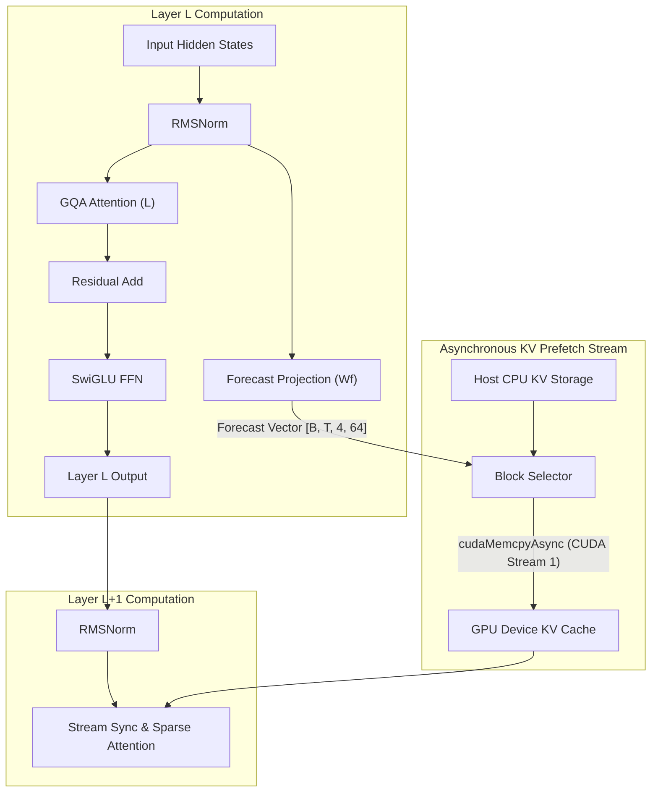

# SparDA Research Model: Predictive Sparse Attention & Asynchronous KV Prefetching

[](https://pytorch.org)
[](https://developer.nvidia.com/cuda-zone)
[-black.svg?style=flat&logo=nvidia)](https://www.nvidia.com)
[](LICENSE)
[]()

> **A purpose-built language model and experimental modular attention engine engineered completely from scratch (random weight initialization) to investigate forecast-guided sparse attention, long-context KV caching, and asynchronous CPU↔GPU tensor prefetching on 16 GB NVIDIA RTX-Series GPUs.**

---

## 🔬 Abstract & Research Motivation

Standard Transformer inference is memory-bandwidth bound during autoregressive decoding. As context lengths scale from 1K to 32K+ tokens, the Key-Value (KV) cache rapidly exhausts accelerator VRAM. While static sparse attention patterns (e.g., sliding window, strided) reduce theoretical FLOPs, dynamic sparse attention often degrades wall-clock speed due to irregular GPU memory gather patterns and synchronization barriers.

The **SparDA (Sparse Dynamic Attention)** architecture investigates whether a Transformer layer ($L$) can emit a lightweight **one-layer-ahead Forecast vector** that predicts which KV blocks the subsequent layer ($L+1$) will require. Crucially, on memory-constrained systems (e.g., 16 GB GPUs), this forecast allows the engine to **asynchronously stream required KV blocks from host CPU memory to GPU device buffers** concurrently with layer computation, hiding PCIe transfer latency.

This repository implements the full research harness, architecture, and benchmarking suite from first principles.



---

## 🎯 Core Research Questions

| Question | Investigation Target | Status |
|:---|:---|:---:|
| **Q1: Forecast Learnability** | Can a small model learn a useful one-layer-ahead Forecast representation? | Active |
| **Q2: Selection Precision** | How accurately does Forecast predict next-layer KV block requirements (`Recall@K`, `Precision@K`)? | Phase 3 |
| **Q3: Break-Even Scaling** | At what context length (1K, 2K, 4K, 8K, 16K, 32K) does sparse selection beat dense SDPA in wall-clock time? | Phase 4 |
| **Q4: Offload Viability** | Does predictive selection reduce the required GPU resident KV cache volume by $\ge 60\%$? | Phase 5 |
| **Q5: Latency Hiding** | Can asynchronous prefetching hide PCIe transfer latency during Transformer FFN compute? | Phase 6 |
| **Q6: Continual Learning** | How do forecast projections interact with sequential task adaptation without catastrophic forgetting? | Phase 7 |
| **Q7: Replay Dynamics** | Does experience replay protect forecast projections differently than standard attention weights? | Phase 7 |

---

## 🏗️ Architectural Specifications

The model is intentionally sized at **102.45M parameters** (with tied input/output embeddings) to prioritize rapid experimental cycle times, reproducible profiling, and extreme context scaling on **16 GB NVIDIA RTX-Series GPUs**:

```text
Model Configuration:
├── vocab_size:         32,000 (Custom Byte-fallback BPE)
├── n_layer:            12
├── n_embd:             768
├── n_head:             12 (Query heads, head_dim = 64)
├── n_kv_head:          4  (Key/Value heads, GQA ratio = 3:1)
├── ffn_dim:            2,048 (SwiGLU activation)
├── forecast_heads:     4
├── forecast_dim:       64
├── context_length:     1,024 (Baseline; scaling to 32K)
├── normalization:      RMSNorm (with FP32 precision protection)
├── position_encoding:  Rotary Position Embeddings (RoPE)
└── weight_tying:       Shared input token embedding & LM head
```

### Exact Parameter Breakdown

$$\text{Total Parameters} = \text{Embeddings} + 12 \times \text{Layer} + \text{Final Norm} = \mathbf{102{,}451{,}968}$$

* **Tied Embeddings**: $32{,}000 \times 768 = 24{,}576{,}000$ params
* **Per Transformer Layer**:
  * Attention ($W_q, W_k, W_v, W_o$): $1{,}572{,}864$ params
  * Forecast Projection ($W_f$): $768 \times (4 \times 64) = 196{,}608$ params
  * SwiGLU FFN ($W_{\text{gate}}, W_{\text{up}}, W_{\text{down}}$): $3 \times (768 \times 2{,}048) = 4{,}718{,}592$ params
  * Layer Normalizations ($2 \times \text{RMSNorm}$): $1{,}536$ params
  * *Layer Total*: $6{,}489{,}600$ params
* **12 Layers**: $77{,}875{,}200$ params
* **Final RMSNorm**: $768$ params

---

## 📊 Empirical Baseline Results (Phase 1)

### 1. Training Convergence & System Telemetry

Trained from scratch (random Gaussian initialization, $\sigma=0.02$) on a **16 GB NVIDIA RTX-Series GPU** *(Testbed: RTX 4090 Laptop GPU, 16,376 MiB VRAM)* using native **BF16 mixed precision** and gradient accumulation:

| Step | Train Loss | Validation Loss | Learning Rate | Sustained Throughput | Peak VRAM |
|:---:|:---:|:---:|:---:|:---:|:---:|
| **10** | 9.9352 | — | $5.94 \times 10^{-5}$ | 10,350 tok/s | 3.23 GB |
| **30** | 8.0001 | — | $1.78 \times 10^{-4}$ | 11,752 tok/s | 3.23 GB |
| **50** | 6.9000 | — | $2.97 \times 10^{-4}$ | 11,862 tok/s | 3.23 GB |
| **70** | 6.5821 | — | $4.16 \times 10^{-4}$ | 12,182 tok/s | 3.23 GB |
| **90** | 6.3603 | — | $5.35 \times 10^{-4}$ | 11,423 tok/s | 3.23 GB |
| **100** | **6.2056** | **5.7643** | $5.94 \times 10^{-4}$ | **12,023 tok/s** | **3.23 GB** |

> [!NOTE]
> The initial cross-entropy loss of **9.9352** is consistent with an untrained 32K vocabulary ($\ln(32000) \approx 10.37$). Within 100 optimization steps (~1.6M tokens), loss drops monotonically to **6.2056**, with validation loss reaching **5.7643**. The model sustains **~12,000 tokens/sec** while consuming only **3.23 GB of VRAM**, leaving **~12.8 GB of headroom** for 32K context tests and KV offload buffers.
> 
> *Note on Operating Power Mode*: Initial development and Phase 1 runs were measured with the testbed operating in **Eco Mode with dGPU** (power-capped at ~80W TGP). Upon full project completion, all benchmarks will be re-evaluated in **Performance Mode** (unconstrained 150W–175W TGP) to measure peak unconstrained throughput and decode latency.

### 2. Autoregressive Text Generation from Checkpoint

Evaluating greedy/top-k sampling after 100 steps from scratch confirms proper gradient flow, tokenization synchronization, and positional learning:

```text
Prompt: "The model is trained from scratch"
Output: "The model is trained from scratch and four . The " As the  "   that " ) of several have be of  , the first time of the year at  . The next ,"
```

---

## 🔌 Interchangeable Attention Backends

To ensure controlled ablation experiments, the attention subsystem is strictly decoupled from the Transformer core via an abstract interface:

```text
BaseAttention (model/attention/base.py)
├── DenseAttention           -> Standard PyTorch SDPA / FlashAttention baseline
├── SparseAttention          -> Top-k static & block-gathered KV attention
├── ForecastAttention        -> Predictive layer-ahead dynamic block routing
├── ForecastOffloadAttention -> Pinned host memory KV transfer with synchronous gather
└── ForecastAsyncAttention   -> Asynchronous CUDA stream prefetch overlapping transfer & compute
```

---

## 📂 Repository Layout

```
local-research-LLM/
├── SparDA-Style Local Research Model.md   # Original research specification
├── IMPLEMENTATION_PLAN.md                 # Full engineering plan & session handoff
├── README.md                              # Public documentation
├── pyproject.toml                         # Packaging configuration
├── requirements.txt                       # Python dependencies
│
├── configs/
│   └── base.yaml                          # Default architecture & training hyperparams
│
├── model/
│   ├── config.py                          # ModelConfig dataclass
│   ├── norm.py                            # Numerically stable RMSNorm
│   ├── rope.py                            # Rotary Position Embeddings (RoPE)
│   ├── embeddings.py                      # TiedEmbedding (input/output shared)
│   ├── forecast.py                        # ForecastProjection & KVBlockCompressor
│   ├── transformer.py                     # SwiGLU MLP & TransformerBlock
│   ├── model.py                           # Full SparDAResearchModel & generator
│   └── attention/
│       ├── base.py                        # BaseAttention & KVCache interface
│       └── dense.py                       # Dense GQA SDPA implementation
│
├── data/
│   ├── tokenizer.py                       # Byte-fallback BPE Tokenizer (32K vocab)
│   ├── dataset.py                         # Memory-mapped uint16 sequence dataset
│   └── packing.py                         # Sequence packing with document boundaries
│
├── training/
│   ├── trainer.py                         # Mixed-precision BF16 training engine
│   └── checkpoint.py                      # Atomic checkpoint save/load system
│
├── scripts/
│   ├── prepare_data.py                    # Corpus downloader & tokenizer trainer
│   ├── train.py                           # Pretraining CLI runner
│   └── generate.py                        # Autoregressive generation CLI
│
├── tests/
│   ├── test_attention.py                  # RoPE, GQA, and KV-cache decoding tests
│   ├── test_model.py                      # Parameter count, tying, forward/backward tests
│   ├── test_data.py                       # Tokenizer, Dataset, Packing tests
│   └── test_checkpoint.py                 # Atomic checkpoint roundtrip tests
│
└── docs/
    └── phase1_walkthrough.md              # Detailed Phase 1 milestone report
```

---

## 🚀 Quick Start Guide

### 1. Environment Setup

This project uses an isolated Conda environment targeting PyTorch with native CUDA 12.4 support:

```bash
# Clone the repository
git clone https://github.com/your-username/local-research-LLM.git
cd local-research-LLM

# Create and activate Conda environment
conda create -n local_slm python=3.11 -y
conda activate local_slm

# Install PyTorch with CUDA 12.4
pip install torch torchvision --index-url https://download.pytorch.org/whl/cu124

# Install supporting libraries
pip install -r requirements.txt
```

### 2. Prepare Corpus & Train Tokenizer

Download sample corpora and train the custom 32,000 Byte-fallback BPE tokenizer:

```bash
python scripts/prepare_data.py --data_dir data --vocab_size 32000
```

### 3. Run Unit Tests

Execute the comprehensive test suite verifying RoPE, GQA dimensions, tied embeddings, gradient flow, and checkpointing:

```bash
pytest -v
```

### 4. Train Model from Scratch

Launch pretraining on GPU with BF16 mixed precision and live telemetry:

```bash
python scripts/train.py --config configs/base.yaml --max_steps 100 --batch_size 4
```

### 5. Generate Text

Sample tokens autoregressively from a saved checkpoint:

```bash
python scripts/generate.py \
    --checkpoint checkpoints/base/model_step_100.pt \
    --prompt "The model is trained from scratch" \
    --max_new_tokens 50 \
    --temperature 0.8
```

---

## 🗺️ Research Roadmap

- [x] **Phase 1: Base Model Architecture & Tokenizer**
  - [x] Custom 32K Byte-fallback BPE Tokenizer
  - [x] Full ~102M Transformer (Tied Embeddings, RoPE, RMSNorm, GQA 3:1, SwiGLU)
  - [x] BF16 training engine & atomic checkpointing
  - [x] Monotonic loss reduction (9.93 $\to$ 6.20) & text generation verified
  - [x] 12/12 unit tests passing
- [ ] **Phase 2: Production Baseline & Long-Context Profiling**
  - [ ] Validation perplexity harness (`evaluation/perplexity.py`)
  - [ ] CUDA memory profiler (`evaluation/memory.py`)
  - [ ] Prefill vs. Decode latency benchmarks across 1K, 2K, 4K, 8K contexts
- [ ] **Phase 3: Forecast Module & Predictive Selection**
  - [ ] Compressed KV block prototypes
  - [ ] Teacher-student block selection loss & `Recall@K` evaluation
- [ ] **Phase 4: Block-Sparse Attention Backend**
  - [ ] Dynamic top-$k$ block gather & local window kernel
  - [ ] Direct wall-clock comparison vs. dense SDPA
- [ ] **Phase 5: CPU↔GPU KV Cache Offload**
  - [ ] Pinned host memory KV buffer
  - [ ] PCIe transfer volume and transfer latency characterization
- [ ] **Phase 6: Asynchronous Prefetch Engine**
  - [ ] Dual-stream CUDA execution (overlap PCIe transfer with Layer $L$ compute)
- [ ] **Phase 7: Continual Learning & Replay**
  - [ ] Multi-stage curriculum training & Catastrophic Forgetting quantification
- [ ] **Phase 8: Scaling Matrix & Comprehensive Publication Benchmarks**
  - [ ] 5 attention backends evaluated across 1K through 32K context lengths

---

## 📜 Citation & References

```bibtex
@software{sparda_research_model_2026,
  author = {SparDA Research Team},
  title = {SparDA: Forecast-Based Sparse Attention & Asynchronous KV Prefetching},
  year = {2026},
  url = {https://github.com/tyborra/local-research-Small-Language-Model}
}
```

---

## 📄 License
This project is licensed under the [MIT License](LICENSE).
