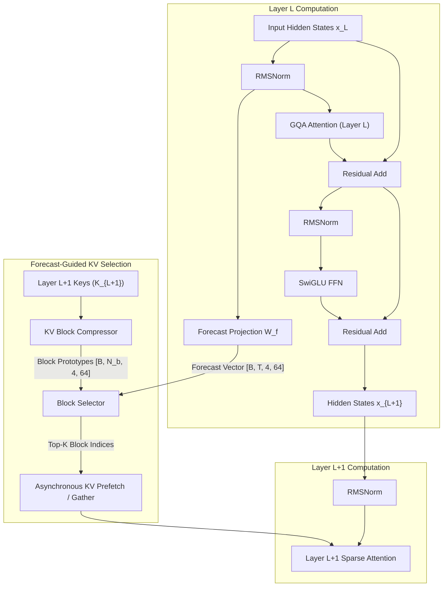

# SparDA: Local Predictive Sparse Attention & Long-Context Research Model

[](https://pytorch.org)
[](https://developer.nvidia.com/cuda-zone)
[](https://www.python.org/)
[](https://www.nvidia.com)
[]()
[](LICENSE)

> **A purpose-built language model and experimental modular attention engine engineered completely from scratch (randomly initialized weights, custom 32K BPE tokenizer) to investigate one-layer-ahead forecast sparse attention, long-context scaling (1K–32K), and asynchronous CPU↔GPU KV prefetching on commodity 16 GB NVIDIA GPUs.**

---

## 🔬 Overview & Motivation

Autoregressive inference in Transformer language models is fundamentally memory-bandwidth bound. As sequence lengths scale from 1K towards 32K+ tokens, Key-Value (KV) cache memory footprints grow linearly with context length and batch size, rapidly exhausting accelerator High-Bandwidth Memory (HBM/VRAM). While static sparse attention mechanisms (such as fixed sliding windows or strided patterns) reduce theoretical computational FLOPs, dynamic content-dependent sparse attention frequently underperforms in wall-clock latency due to irregular memory access patterns, non-contiguous indexing, and GPU kernel launch overhead.

**SparDA (Sparse Dynamic Attention)** explores a predictive architectural alternative: enabling each Transformer layer ($L$) to project a lightweight **one-layer-ahead Forecast representation** that anticipates the specific KV memory blocks required by the subsequent layer ($L+1$). On memory-constrained accelerators (such as commodity 16 GB GPUs), this predictive routing establishes the foundation for **asynchronous CPU↔GPU KV prefetching**—streaming targeted KV blocks across the PCIe bus concurrently with feed-forward network computation to effectively overlap data transfer and execution latencies.

### Key Technical Contributions & Milestones:
- **Pretrained from First Principles**: Designed, initialized, and trained entirely from scratch using random Gaussian initialization, strictly independent of existing pretrained model families (e.g., Llama, Qwen, Mistral).
- **Custom Modern Transformer Architecture**: 102.45M parameter model incorporating tied input/output embeddings, Rotary Position Embeddings (RoPE), FP32-stabilized RMSNorm, Grouped-Query Attention (GQA 3:1 ratio with 12 Query heads and 4 KV heads), and SwiGLU activation.
- **Hardware-Accelerated BF16 Infrastructure**: Integrated native PyTorch SDPA (FlashAttention-2 / CuDNN kernels), mixed-precision forward/backward passes, gradient checkpointing, and transactional atomic checkpoint management.
- **Empirically Benchmarked Context Scaling (1K–16K)**: Rigorous profiling using CUDA event synchronization demonstrating prefill throughput scaling up to **40,818 tok/s** and an ultra-lean **192.88 MB KV-cache footprint** at 16,384 tokens (leaving **14.23 GB of VRAM headroom** on a 16 GB device).
- **Predictive Forecast Module (Phase 3 Verified)**: Production implementation of KV block compression, scaled dot-product block routing, teacher extraction from full dense attention distributions, and auxiliary supervision losses. Real-world evaluation confirms **~58.5% Recall@8** and **~37.5% Recall@4** across all 11 layer transitions.
- **Comprehensive Verification Suite**: **23/23 unit tests passing** covering attention mechanics, RoPE expansion, KV cache decoding, sequence packing, memory telemetry, and forecast routing.

---

## 🔬 System Architecture & Forecast Pipeline

The SparDA architecture decouples attention computation through interchangeable backends while feeding forward predictive representations across consecutive layers:



---

## 🏗️ Architectural Specifications

The model is sized at **102.45M parameters** (24.58M tied embeddings + 77.88M layers) to balance rapid research iteration with realistic deep representation learning on a **16 GB GPU**:

```text
Model Configuration:
├── vocab_size:         32,000 (Custom Byte-fallback BPE trained from raw text)
├── n_layer:            12
├── n_embd:             768
├── n_head:             12 (Query heads, head_dim = 64)
├── n_kv_head:          4  (Key/Value heads, GQA ratio = 3:1)
├── ffn_dim:            2,048 (SwiGLU activation)
├── forecast_heads:     4
├── forecast_dim:       64
├── context_length:     1,024 (Baseline; scalable to 2K, 4K, 8K, 16K, 32K)
├── normalization:      RMSNorm (eps = 1e-6, FP32 accumulator)
├── position_encoding:  Rotary Position Embeddings (RoPE, theta = 10,000)
└── weight_tying:       Shared input token embedding & LM output head
```

### Parameter Breakdown:
* **Tied Embeddings**: $32{,}000 \times 768 = 24{,}576{,}000$ params
* **Per Transformer Layer**:
  * Attention Projections ($W_q, W_k, W_v, W_o$): $1{,}572{,}864$ params
  * Forecast Projection ($W_f$): $768 \times (4 \times 64) = 196{,}608$ params
  * SwiGLU FFN ($W_{\text{gate}}, W_{\text{up}}, W_{\text{down}}$): $3 \times (768 \times 2{,}048) = 4{,}718{,}592$ params
  * Normalizations ($2 \times \text{RMSNorm}$): $1{,}536$ params
  * *Per Layer Total*: $6{,}489{,}600$ params
* **12 Layers**: $77{,}875{,}200$ params
* **Final RMSNorm**: $768$ params
* **Total Parameters**: $\mathbf{102{,}451{,}968}$

---

## 📊 Empirical Results & Benchmarks

### 1. Context Scaling Matrix (1K to 16K on 16 GB GPU)
Measured in BF16 precision with PyTorch SDPA using synchronized CUDA events (`torch.cuda.Event`):

| Context Length | Batch | Prefill Latency | Prefill Throughput | Decode Latency | Decode Throughput | KV Cache VRAM | Peak VRAM | VRAM Headroom |
|:---:|:---:|:---:|:---:|:---:|:---:|:---:|:---:|:---:|
| **1K (1,024)** | 1 | 73.37 ms | 13,956 tok/s | 61.34 ms/tok | 16.3 tok/s | 12.00 MB | 0.67 GB | 15.32 GB |
| **2K (2,048)** | 1 | 75.66 ms | 27,070 tok/s | 67.90 ms/tok | 14.7 tok/s | 24.00 MB | 0.74 GB | 15.25 GB |
| **4K (4,096)** | 1 | 100.35 ms | **40,818 tok/s** | 64.81 ms/tok | 15.4 tok/s | 49.88 MB | 0.88 GB | 15.11 GB |
| **8K (8,192)** | 1 | 229.52 ms | 35,692 tok/s | 56.76 ms/tok | 17.6 tok/s | 96.88 MB | 1.18 GB | 14.82 GB |
| **16K (16,384)** | 1 | 729.05 ms | 22,473 tok/s | 59.24 ms/tok | 16.9 tok/s | **192.88 MB** | 1.77 GB | **14.23 GB** |

> [!TIP]
> **Key Finding**: Thanks to Grouped-Query Attention (4 KV heads), the full 16,384-token KV cache occupies only **192.88 MB**, consuming less than 1.8 GB of peak VRAM during generation and leaving over **14.2 GB of headroom** on a 16 GB GPU for asynchronous buffer swapping.

### 2. Pretraining Convergence from Scratch (Phase 1)
Trained with BF16 mixed precision and AdamW ($\beta_1=0.9, \beta_2=0.95$):
- **Initial Cross-Entropy Loss**: `9.9352` (close to theoretical $\ln(32000) \approx 10.37$)
- **Step 100 Loss**: `6.2056` (monotonic decrease across optimization steps)
- **Validation Loss**: `5.8189 nats` / **Validation Perplexity**: `336.59` (over 237,568 held-out tokens)
- **Evaluation Throughput**: `39,066 tokens/sec`

### 3. Forecast Accuracy vs. Teacher Attention (Phase 3)
Evaluated across all 11 layer transitions (`Layer L` forecast predicting `Layer L+1` attention blocks) on validation sequences:
- **Recall@8**: **58.17% – 59.23%** across layers (vs. ~25% for uniform random selection)
- **Recall@4**: **36.57% – 38.47%** across layers
- **Recall@1 (Top-1 Exact Match)**: **11.50% – 14.43%** across layers
- **KL Divergence**: $0.1607 - 1.3316$ between predicted block logits and teacher attention mass

---

## 🔌 Modular Attention Backends

The architecture is built for strict experimental ablation. Different attention mechanisms plug directly into the same model weights without architectural changes:

```text
BaseAttention (model/attention/base.py)
├── DenseAttention           -> Standard PyTorch Flash/SDPA baseline (Phase 1 & 2)
├── SparseAttention          -> Top-K block-gathered sparse attention (Phase 4)
├── ForecastAttention        -> Predictive layer-ahead dynamic block routing (Phase 4)
├── ForecastOffloadAttention -> Pinned CPU host KV transfer with synchronous gather (Phase 5)
└── ForecastAsyncAttention   -> Asynchronous dual CUDA stream prefetching (Phase 6)
```

---

## 🗺️ Project Roadmap & Status

- [x] **Phase 1: Base Model Architecture & Tokenizer**
  - [x] Custom 32K Byte-fallback BPE Tokenizer trained from raw text
  - [x] Full ~102M Transformer (Tied Embeddings, RoPE, RMSNorm, GQA 3:1, SwiGLU)
  - [x] Monotonic pretraining loss reduction (9.93 $\to$ 6.20) & verified text generation
- [x] **Phase 2: Production Baseline & Long-Context Profiling**
  - [x] Validation loss and perplexity evaluation harness (`evaluation/perplexity.py`)
  - [x] Analytical and real-world CUDA memory profiler (`evaluation/memory.py`)
  - [x] Prefill vs. Decode latency benchmarks from 1K to 16K context lengths (`docs/results.md`)
- [x] **Phase 3: Forecast Module & Predictive Selection**
  - [x] KV Block Compressor with prototype mean-pooling and sequence padding
  - [x] Scaled dot-product Forecast Block Selector with causal masking
  - [x] Teacher Block Selector extracting ground-truth targets from dense attention maps
  - [x] Auxiliary Forecast Loss (`KL` and `BCE`) and metrics (`Recall@K`, `Precision@K`)
  - [x] Full 11-layer evaluation benchmark (`scripts/benchmark_forecast.py`)
- [ ] **Phase 4: Block-Sparse Attention Backend** *(In Progress)*
  - [ ] Block gather mechanism and Top-K sparse GQA attention (`model/attention/sparse.py`)
  - [ ] Direct wall-clock latency/throughput comparison vs. dense baseline
- [ ] **Phase 5: CPU↔GPU KV Cache Offload**
  - [ ] Pinned host memory KV buffer & PCIe transfer latency characterization
- [ ] **Phase 6: Asynchronous Prefetch Engine**
  - [ ] Dual-stream CUDA execution (overlap PCIe transfer with Layer $L$ computation)
- [ ] **Phase 7: Continual Learning & Experience Replay**
  - [ ] Multi-stage sequential curriculum & catastrophic forgetting metrics
- [ ] **Phase 8: Comprehensive Publication Benchmarks**
  - [ ] 5-way architecture comparison across 1K through 32K context lengths

---

## 🚀 Quickstart & Reproducibility Guide

### 1. Environment Installation

This repository targets PyTorch with native CUDA 12.4 acceleration:

```bash
# Clone the repository
git clone https://github.com/tyborra/local-research-Small-Language-Model.git
cd local-research-Small-Language-Model

# Create and activate Conda environment
conda create -n local_slm python=3.11 -y
conda activate local_slm

# Install PyTorch with CUDA 12.4
pip install torch torchvision --index-url https://download.pytorch.org/whl/cu124

# Install dependencies
pip install -r requirements.txt
```

### 2. Run the Unit Test Suite

Execute the full suite of **23 unit tests**:

```bash
pytest -v
```

### 3. Evaluate Validation Perplexity

Evaluate the trained checkpoint against held-out validation data:

```bash
python scripts/evaluate.py --config configs/base.yaml --checkpoint checkpoints/base/model_step_100.pt
```

### 4. Run the Dense Context Scaling Benchmark

Benchmark prefill latency, decode latency, KV cache size, and peak VRAM across 1K, 2K, 4K, 8K, and 16K:

```bash
python benchmarks/dense.py --contexts 1024 2048 4096 8192 16384
```

### 5. Evaluate Forecast Prediction Accuracy

Test the predictive alignment between Layer $L$ Forecast vectors and Layer $L+1$ attention maps:

```bash
python scripts/benchmark_forecast.py --block_size 32 --max_batches 10
```

### 6. Autoregressive Text Generation

Sample tokens from the trained checkpoint:

```bash
python scripts/generate.py \
    --checkpoint checkpoints/base/model_step_100.pt \
    --prompt "The model is trained from scratch" \
    --max_new_tokens 50 \
    --temperature 0.8
```

---

## 📂 Repository Layout

```text
local-research-LLM/
├── SparDA-Style Local Research Model.md   # Core research specification
├── IMPLEMENTATION_PLAN.md                 # Detailed phased engineering plan
├── README.md                              # Main publication documentation
├── pyproject.toml                         # Project package configuration
├── requirements.txt                       # Python dependencies
│
├── configs/                               # Context scaling configurations
│   ├── base.yaml                          # Default 1K configuration
│   ├── 1k.yaml, 2k.yaml, 4k.yaml          # Scaling YAML configs
│   ├── 8k.yaml, 16k.yaml                  # Extended context configs
│
├── model/                                 # Core model primitives
│   ├── config.py                          # Hyperparameter dataclass
│   ├── norm.py                            # FP32-stabilized RMSNorm
│   ├── rope.py                            # Rotary Position Embeddings
│   ├── embeddings.py                      # TiedEmbedding (input/output weight sharing)
│   ├── forecast.py                        # ForecastProjection, Compressor, Selectors, Loss
│   ├── transformer.py                     # SwiGLU MLP & TransformerBlock
│   ├── model.py                           # Full SparDAResearchModel & generator
│   └── attention/
│       ├── base.py                        # BaseAttention abstract interface & KVCache
│       └── dense.py                       # Dense GQA SDPA implementation
│
├── data/                                  # Data pipeline
│   ├── tokenizer.py                       # Custom 32K Byte-fallback BPE Tokenizer
│   ├── dataset.py                         # Memory-efficient uint16 token dataset
│   └── packing.py                         # Sequence packing utilities
│
├── training/                              # Training infrastructure
│   ├── trainer.py                         # Mixed-precision BF16 training engine
│   └── checkpoint.py                      # Atomic checkpoint save/load system
│
├── evaluation/                            # Evaluation and profiling harnesses
│   ├── perplexity.py                      # Perplexity and bits-per-token evaluator
│   ├── memory.py                          # Analytical and CUDA VRAM profiler
│   ├── latency.py                         # CUDA-event synchronized latency benchmarker
│   └── forecast_metrics.py                # Recall@K, Precision@K, KL Divergence
│
├── benchmarks/                            # Benchmark execution suites
│   └── dense.py                           # Dense baseline scaling benchmark
│
├── scripts/                               # CLI entrypoints
│   ├── prepare_data.py                    # Dataset download and tokenizer trainer
│   ├── train.py                           # Pretraining runner
│   ├── generate.py                        # Generation CLI
│   ├── evaluate.py                        # Validation evaluation runner
│   └── benchmark_forecast.py              # Forecast vs. Teacher benchmark runner
│
├── tests/                                 # Pytest test suite (23 unit tests)
│   ├── test_attention.py                  # RoPE, GQA, and KV-cache decoding tests
│   ├── test_model.py                      # Architecture, tying, and forward/backward tests
│   ├── test_data.py                       # Tokenizer, Dataset, and packing tests
│   ├── test_checkpoint.py                 # Atomic checkpoint roundtrip tests
│   ├── test_evaluation.py                 # Perplexity, memory, and latency tests
│   └── test_forecast.py                   # Forecast projection, compressor, and selector tests
│
└── docs/                                  # Research walkthroughs and data
    ├── phase1_walkthrough.md              # Phase 1 completion report
    ├── phase2_walkthrough.md              # Phase 2 baseline benchmark report
    ├── phase3_walkthrough.md              # Phase 3 forecast module report
    ├── results.md                         # Live empirical benchmark tables
    └── dense_benchmark.json               # Raw JSON telemetry data
```

---

## 📜 Citation

If you use this work or reference the SparDA architecture in your research:

```bibtex
@software{borras_sparda_2026,
  author = {Tyler Borras},
  title = {SparDA: Predictive Sparse Attention and Long-Context Research Model},
  year = {2026},
  url = {https://github.com/tyborra/local-research-Small-Language-Model}
}
```

---

## 📄 License

This project is licensed under the [MIT License](LICENSE).
